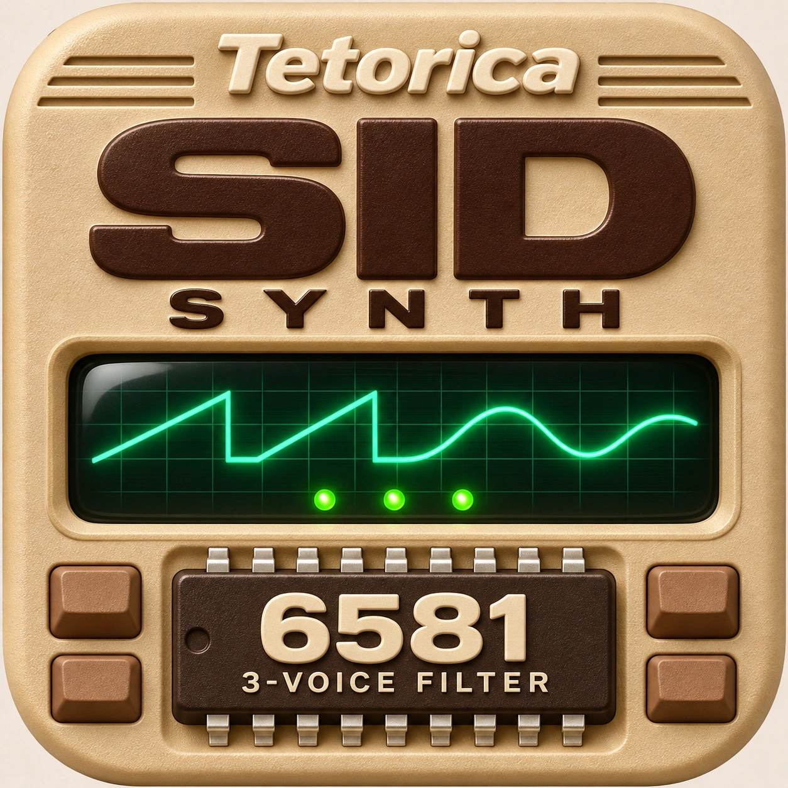

# Tetorica SID Synth — Desktop



Explore C64 SID sound in a Tauri desktop app. This repository wraps
[Tetorica SID Synth](https://kyorohiro.github.io/hello_ymfm_wasm/synth-sid/index.html)
with the Menu, Pin and audio-output controls used by the other Tetorica Synths.

Desktop version **0.0.1** includes readable Web sources. The imported ZIP and
every extracted file are pinned by SHA-256 in [release.lock.json](release.lock.json).

## Sound and desktop controls

- 6581 approximation and 8580 Preview, three physical voices, Triangle / Saw /
  Pulse / Noise combinations, hardware ADSR, Sync / Ring and a shared filter.
- Independent LP / BP / HP filter outputs with shared Cutoff and Resonance.
- CH 1 / 2 / 3 editing and keyboard playing, or Round robin across the three
  preserved channel sounds. Fixed channels can use software Retrigger / Legato.
- Load a supported local SID, preview and Pause / Resume the song, observe a
  channel through the same controls and capture its current voice settings.
  A snapshot does not reconstruct the original instrument's time automation.
- Portable voice presets and channel setups, readable JavaScript export,
  Master up to 380%, Pitch, Octave and a waveform / spectrum monitor.
- **Menu** groups SID import, voice / channel setup saving, output selection
  and reload. **Pin** keeps the window on top. Reload asks before clearing edits.

**Web Audio** is the default. **Native (Rust)** sends the active final stereo
Master output to a CPAL device. Both modes use the same WASM / AudioWorklet
renderer; Rust handles device output, Pin and native file saving. The keyboard
and SID song preview have separate audio contexts. Native output follows the
active context before the next keyboard attack or preview starts.

Explicit output / device changes stop held keys and song playback, reset Pitch
and keep the selected file and instrument settings. The output monitor stays
on the same final bus. This is native device output, not a separate native SID
renderer. Model accuracy, hardware envelope quirks and SID-file compatibility
remain those of the included Web version.

See the [included Synth guide](dist/README.md) for controls and import limits.

## Run locally

Install Node.js, Python 3, Rust and the platform's
[Tauri prerequisites](https://v2.tauri.app/start/prerequisites/), then run:

```sh
npm ci
python3 scripts/import_release.py --check
npm test
npm run test:native
npm run dev
```

On Windows, use `python` if `python3` is unavailable.

For an unsigned macOS app:

```sh
npm run build -- --bundles app --no-sign -- --locked
```

The default local output is
`src-tauri/target/release/bundle/macos/Tetorica SID Synth.app`.
For separate signed Intel and Apple Silicon app / DMG builds, export
`APPLE_SIGNING_IDENTITY`, `APPLE_ID`, `APPLE_PASSWORD` and `APPLE_TEAM_ID`, then
run `sh deploy_mac.sh`. Keep signing credentials in your environment.

## Inspect and modify the code

Application JavaScript and CSS retain module boundaries, comments and names.
The desktop build does not bundle, minify or obfuscate these sources.

| Location | Purpose |
| --- | --- |
| [dist/synth-sid](dist/synth-sid/) | Readable Synth UI, channel settings, Legato, SID import and Live controls |
| [dist/sid-player](dist/sid-player/) | SID song preview, model selection, transport and voice capture |
| [dist/js](dist/js/) | Reusable chip APIs and runtime dependencies |
| [dist/generated](dist/generated/) | Matching SID / C64 WASMs and build receipts |
| [dist/sources](dist/sources/) | Original browser sources, matching native sources, licenses and build recipes |
| [desktop](desktop/) | Menu / Pin, native saving and final-bus output adapters |
| [src-tauri/src](src-tauri/src/) | Tauri host and CPAL output |

Desktop adapters are appended by the local resource server. Imported files in
`dist/` retain their original bytes. To edit them, make changes and record them:

```sh
npm run record:edits
python3 scripts/import_release.py --check
```

`local-changes.json` records edits over the pinned release while preserving its
original hashes. Importing another ZIP replaces `dist/`; keep your changes in
Git and reapply them afterward.

## Import a Web release

Obtain a readable SID Synth ZIP from the parent project, then run:

```sh
npm run import:release -- /path/to/tetorica_sid_synth_VERSION_itch.zip
python3 scripts/import_release.py --check
```

The importer checks product identity, archive paths, readable module receipts,
the enclosed browser source archive, all four SID / C64 native source kits,
their WASM receipts and required notices before replacing `dist/`. Both `dist/`
and `release.lock.json` belong in Git. `.gitattributes` preserves imported bytes
on Windows and other checkout platforms.

## Verification and CI

```sh
npm test
npm run test:browser -- --out artifacts/desktop-browser.json --screenshots artifacts/screenshots
npm run test:audio-transport -- artifacts/audio-transport.json
npm run test:native
cargo fmt --manifest-path src-tauri/Cargo.toml --check
```

Browser checks run the real SID WASMs and AudioWorklets in Chromium / WebKit
with a mocked Tauri host and muted speakers. Transport stress tests simulate
IPC / device scheduling. Default Rust tests do not open an audio device.
Physical-device listening and prolonged WebView playback are separate checks.

[Build Desktop](.github/workflows/build-desktop.yml) configures macOS Apple
Silicon / Intel, Windows x64 and Linux x64 / ARM64 builds. Main-branch builds
produce workflow artifacts. Tags starting with `v` attach installers to a
**draft** GitHub release. CI builds are unsigned; `deploy_mac.sh` uses exported
local signing / notarization credentials. Hosted CI results require pushing
this repository.

Current work and manual checks are recorded in [the TODO](docs/todo_20261108.md)
and [verification notes](docs/verification_20261108.md).

## Sources and licenses

The desktop wrapper uses the [BSD 3-Clause license](LICENSE). Imported modules
retain their original notices. The included SID / C64 components have zlib,
MIT and BSD notices, with toolchain notices in the 8580 source kit:

- [6581 core and rebuilding](dist/sources/SID.md)
- [SID song preview source kits](dist/sources/SID-SONG-PREVIEW.md)
- [8580 Preview sources and notices](dist/sources/SID8580.md)
- [Original browser source archive](dist/sources/sid-synth-browser-inputs.zip)

Useful project links:

- [Tetorica's goals and reusable sound-chip APIs](https://github.com/kyorohiro/hello_ymfm_wasm)
- [SID Synth source](https://github.com/kyorohiro/hello_ymfm_wasm/tree/main/docs/synth-sid)
- [Native sound-chip library](https://github.com/kyorohiro/tetorica-soundchip-native)
- [Tauri](https://tauri.app/)

## 日本語

C64のSIDを試奏するTauri版です。6581／8580 Preview、複合波形、共有Filter、
CH別編集、Round robin、ソフトウェアLegato、SIDの試聴・Pause・Live表示・音色取り込みに対応します。
Web版の可読ソースを含み、共通のMenu・Pin・音声出力設定を追加しています。

初期状態はWeb Audioです。Native出力も同じWASM／AudioWorkletの最終音声を使い、
Rustからデバイスへ送ります。出力切り替え時は鍵盤と曲を停止し、設定・選択ファイルを保持します。
`dist/`の変更は`npm run record:edits`で記録でき、配布コードを改造・再利用しやすい構成です。

実デバイスでの実聴・長時間動作・各OSの最終確認はTODOを参照してください。
